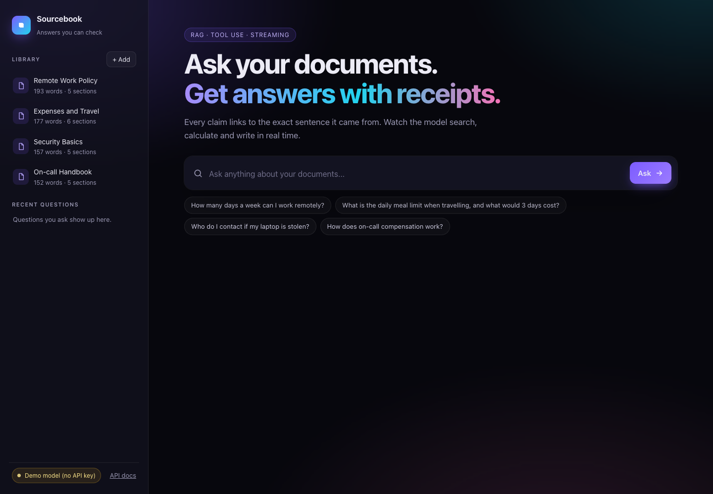
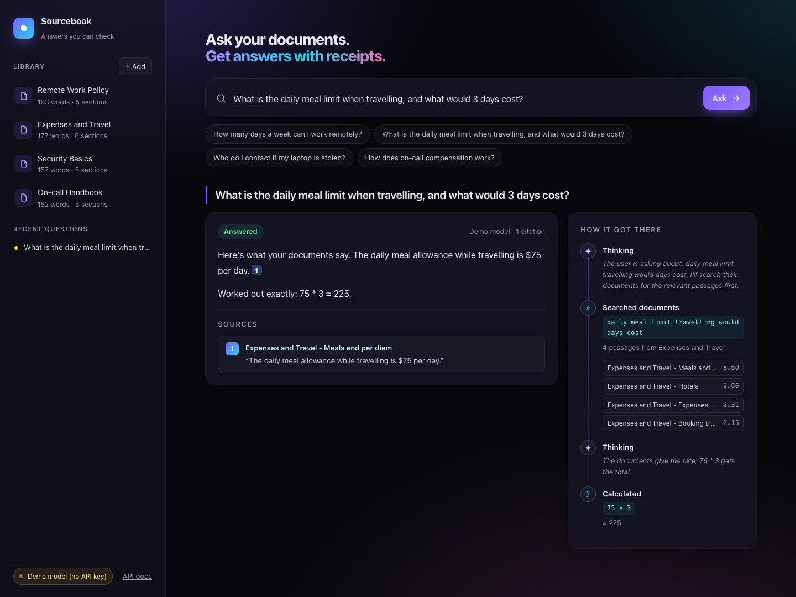
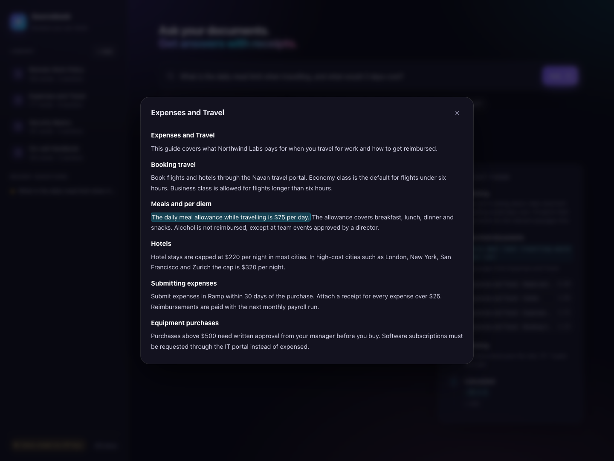
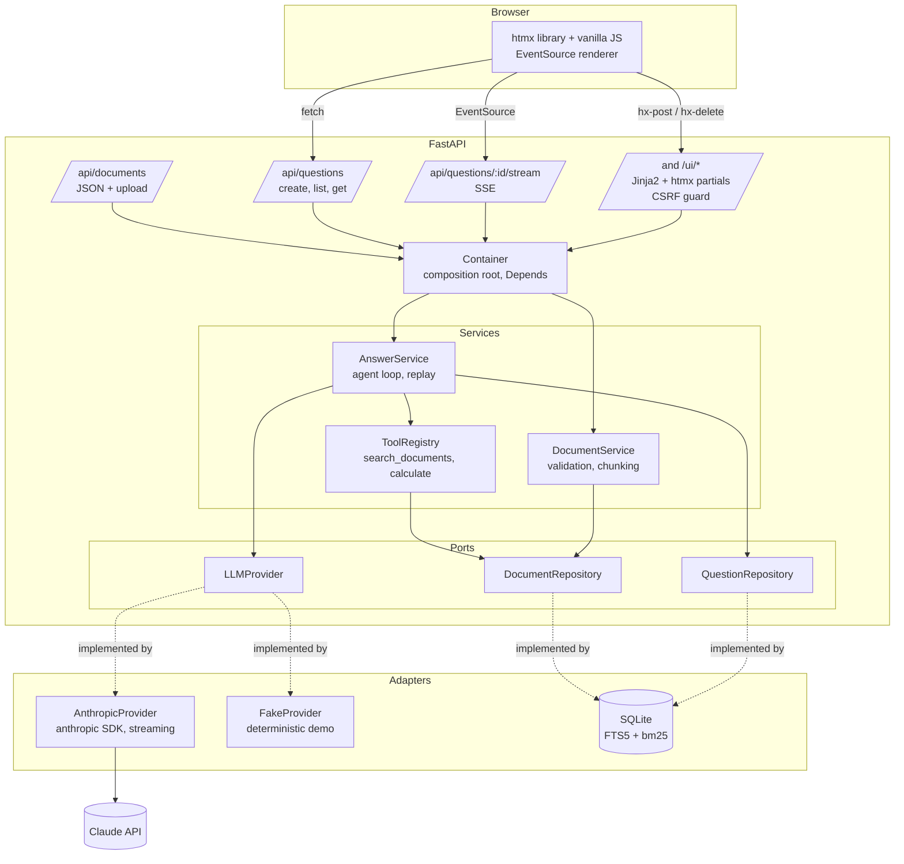
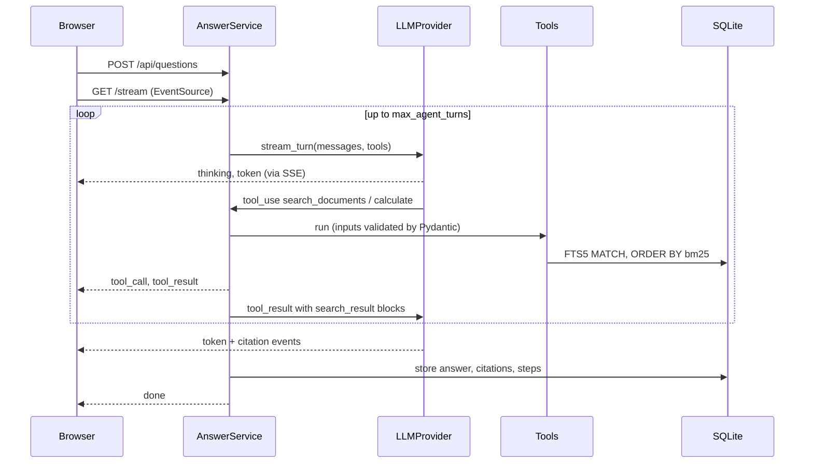

# Sourcebook

Ask questions about your documents and get answers you can check. Every claim links to the exact sentence it came from, and you can watch the model search, calculate and write in real time.

Built by Ramiz Raja as a small but complete example of an AI product on a Python backend: FastAPI with async SQLite, a retrieval-augmented agent loop on the Claude API with tool use and native citations, server-sent events, clean layers behind ports, and tests at two levels with CI.

It runs without an API key. A deterministic demo model stands in for Claude, so you can clone, run and click through everything in a minute. Set `ANTHROPIC_API_KEY` and the same app talks to Claude.

## Features

- **Cited answers.** Answers stream in with numbered markers. Each one opens the source document with the cited sentence highlighted. With Claude these are the API's native citations (`search_result_location`), not references the model typed.
- **Tool use you can see.** The model calls `search_documents` (SQLite FTS5, BM25 ranking, Porter stemming) and `calculate` (a safe arithmetic evaluator, no `eval`). A trace panel shows its thinking summary, each tool call, its input and its results as they happen.
- **Multi-step reasoning.** "What is the daily meal limit, and what would 3 days cost?" searches first, reads the rate, then calls the calculator with `75 * 3`.
- **Streaming over SSE.** Thinking, tool calls, tool results, tokens and citations arrive as typed events on FastAPI's native SSE support.
- **Replayable history.** Finished answers are stored with their citations and tool steps. Opening one from "Recent questions" replays it through the same event stream, so it renders exactly as it did live.
- **Document library.** Paste text or upload `.md` / `.txt`. Documents are split by heading into sections and indexed at once. Ships with a four-document sample handbook for a fictional company.
- **JSON API with OpenAPI docs** at `/docs`, alongside the htmx UI.
- **Demo model.** No key needed. It plans the same kind of tool calls Claude makes, answers extractively from the retrieved sentences and cites them, so the whole pipeline (tools, events, storage, UI) runs for real.

## Screenshots

Captured with Playwright from a local run on the demo model.

| Ask | Answer with sources and trace | Source with the cited sentence |
| --- | --- | --- |
|  |  |  |

## Architecture

**Layers:** API (FastAPI routers, schemas, SSE) → services (agent loop, tools, document use cases) → ports (`LLMProvider`, repositories) → adapters (Claude, demo model, SQLite). Services never import FastAPI, the Anthropic SDK or aiosqlite. A container built once in the app lifespan wires the adapters, and routes get services through `Depends`.



### One answer, step by step



### Folder map

```
src/sourcebook/
  main.py              app factory, lifespan, provider choice, sample seeding
  config.py            Pydantic Settings (SOURCEBOOK_* env vars, ANTHROPIC_API_KEY)
  domain/              models, stream events, typed errors
  ports/               LLMProvider and repository protocols
  services/
    answering.py       agent loop, answer builder, replay of stored answers
    tools.py           ToolRegistry, SearchDocumentsTool, CalculateTool
    calculator.py      AST-based arithmetic evaluator
    chunking.py        heading-aware chunking, title derivation
    documents.py       ingest, upload validation, bounded reads
  adapters/
    llm/claude.py      Claude over the official anthropic SDK
    llm/fake.py        deterministic demo model
    sqlite/            connection and migrations, document + question repositories
  api/                 routers (documents, questions, ui), schemas, deps, error mapping, SSE encoding
  web/                 Jinja2 templates, CSS, app.js, vendored htmx
  seed/                sample handbook (fictional "Northwind Labs")
tests/
  unit/                services, tools, chunking, calculator, providers, SQLite
  api/                 HTTP tests through TestClient, SSE parsing, UI partials, security
```

## Run

You need [uv](https://docs.astral.sh/uv/). It installs the right Python (3.13) itself.

**Without an API key** (demo model):

```bash
uv sync
uv run sourcebook
# open http://127.0.0.1:8000
```

**With Claude:**

```bash
cp .env.example .env
# put your key in .env as ANTHROPIC_API_KEY=...  (or export it in your shell)
uv run sourcebook
```

The sidebar shows which model is answering. `SOURCEBOOK_PROVIDER=auto` (default) uses Claude when a key is set and the demo model otherwise; `fake` and `anthropic` force one. Model and effort are configurable (`SOURCEBOOK_MODEL`, default `claude-opus-5-5`; `SOURCEBOOK_EFFORT`, default `medium`). See `.env.example` for all settings. Keys are only read from the environment and held as `SecretStr`, so they never show up in logs or reprs.

**Docker:**

```bash
docker build -t sourcebook .
docker run -p 8000:8000 -v sourcebook-data:/data sourcebook
# with Claude: add  -e ANTHROPIC_API_KEY
```

The image runs as a non-root user and keeps the database on the `/data` volume.

### API

| Method | Path | What it does |
| --- | --- | --- |
| `GET` | `/api/health` | Status, active provider, document count |
| `GET` | `/api/documents` | List documents (summaries) |
| `POST` | `/api/documents` | Add a document from JSON `{content, title?}` |
| `POST` | `/api/documents/upload` | Upload a `.md` / `.txt` file (multipart) |
| `GET` | `/api/documents/{id}` | Full document with content |
| `DELETE` | `/api/documents/{id}` | Delete a document and its index entries |
| `POST` | `/api/questions` | Ask; returns the question with its `stream_url` |
| `GET` | `/api/questions` | Recent questions |
| `GET` | `/api/questions/{id}` | One question with its answer, citations and steps |
| `GET` | `/api/questions/{id}/stream` | SSE: `thinking`, `tool_call`, `tool_result`, `token`, `citation`, then `done` or `error` |

Errors come back as `{"detail": "..."}` with 404, 413 or 422. Full schemas at `/docs`.

## Test

```bash
uv run ruff check . && uv run ruff format --check .
uv run mypy                       # strict, src and tests
uv run pytest --cov               # branch coverage, fails under 85%
```

**113 tests** (100 unit, 13 API), **98.8% branch coverage** on the last run. The API tests drive the real app through `TestClient` with a temporary SQLite file and the demo model: they create documents, ask questions, parse the SSE stream and check event order, citations, tool inputs and replay. The Claude adapter is unit-tested against a stubbed SDK stream, covering thinking, citations, tool use, refusals and malformed tool JSON.

CI (GitHub Actions) runs lint, format check, mypy and tests with coverage, then builds the Docker image, starts it and polls `/api/health`.

## Security

- **No secrets in the repo.** `.env` is git-ignored; `.env.example` holds placeholders only.
- **Bounded uploads.** Uploads are read with `read(max_bytes + 1)`, and anything over the limit (512 KB by default) is refused with 413, in both the JSON API and the UI.
- **CSRF on UI writes.** `POST` and `DELETE` under `/ui/documents` require the `HX-Request: true` header that htmx sends and, when the browser sends `Origin`, it must match `Host`. A cross-site form cannot set that header, and a cross-site `fetch` that tries triggers a CORS preflight the app never approves.
- **Escaped output.** Jinja2 autoescapes templates. In `app.js` all model and user text goes through one `escapeHtml` before it reaches the DOM.
- **Validated tool inputs.** Every tool parses its input with Pydantic before running. The calculator walks a Python AST with an allow-list of operators and caps exponents; it never calls `eval`.
- **Parameterised SQL** everywhere, and search text is turned into quoted FTS5 terms so query syntax cannot be injected.

There is no authentication: this is a single-user demo. A multi-user deployment would add accounts and scope documents per user before anything else.

## Decisions and trade-offs

- **Retrieval as a tool, not a pre-step.** The model decides what to search for and can search again, which handles follow-ups and comparisons better than stuffing the top-k chunks into every prompt. Results go back as [`search_result` blocks](https://docs.claude.com/en/docs/build-with-claude/search-results), which turns on native citations that point at exact sentences, so the UI highlights the real source instead of trusting model-written references.
- **SQLite FTS5 instead of a vector database.** For a few hundred documents, BM25 with stemming is fast, needs no embedding service and is easy to inspect. The `DocumentRepository` port is where vector or hybrid search would plug in.
- **Claude API settings from the docs.** [Adaptive thinking](https://docs.claude.com/en/docs/build-with-claude/extended-thinking) with summarized display feeds the trace panel. [Prompt caching](https://docs.claude.com/en/docs/build-with-claude/prompt-caching) covers the stable prefix (tools and system prompt) across agent turns. [Streaming](https://docs.claude.com/en/docs/build-with-claude/streaming) with `eager_input_streaming` on [client tools](https://docs.claude.com/en/docs/agents-and-tools/tool-use/overview), with each tool input validated before it runs. Refusals become a clear error instead of an empty answer.
- **The agent loop is ours, not a framework's.** `AnswerService` calls the model, runs the tools it asks for, feeds the results back and stops at `max_agent_turns`. That keeps every event visible to the UI and every step testable with the demo model.
- **A deterministic demo model behind the same port.** Reviewers can run the app without a key, tests are fast and free, and CI never calls a paid API. It is not a mock returning canned strings: it emits the same event types and tool calls, so it exercises the real loop, tools, storage and UI.
- **SSE over WebSockets.** The stream is one-way, passes through proxies, reconnects natively in `EventSource`, and FastAPI supports it directly.
- **Server-rendered UI with htmx plus one small JS module.** The library is plain HTML partials. Only the answer view, which renders a live stream, needs JavaScript. No build step.
- **Async end to end** (aiosqlite, the async Anthropic client, async generators for streams), so one process can serve many slow model calls at once.

### Known limits

- The Claude provider is covered by unit tests against a stubbed SDK stream. The screenshots and API tests use the demo model.
- Upload size is enforced when the handler reads the file. Starlette still spools the multipart body to a temporary file first, so a production deployment should also cap request size at the proxy (for example `client_max_body_size` in nginx).
